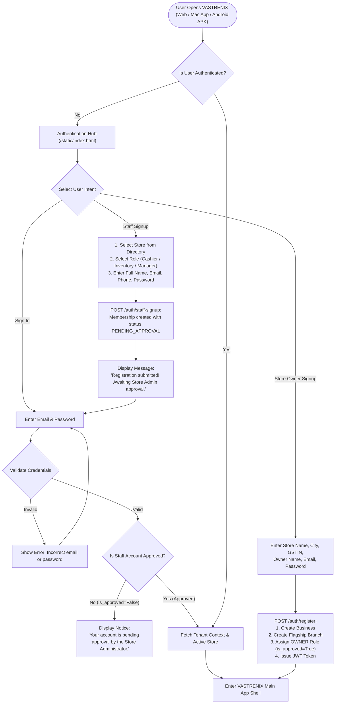
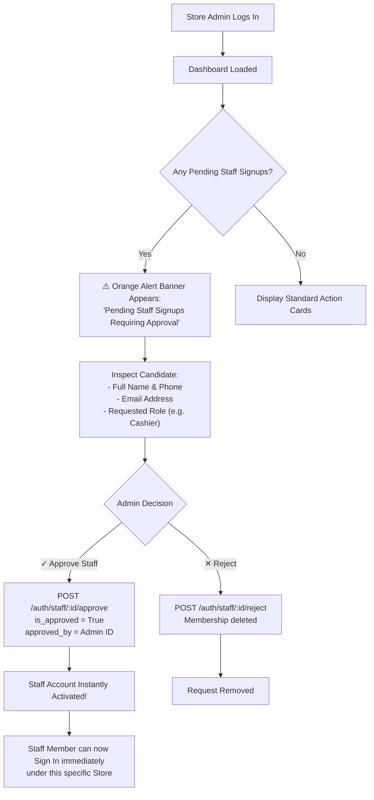
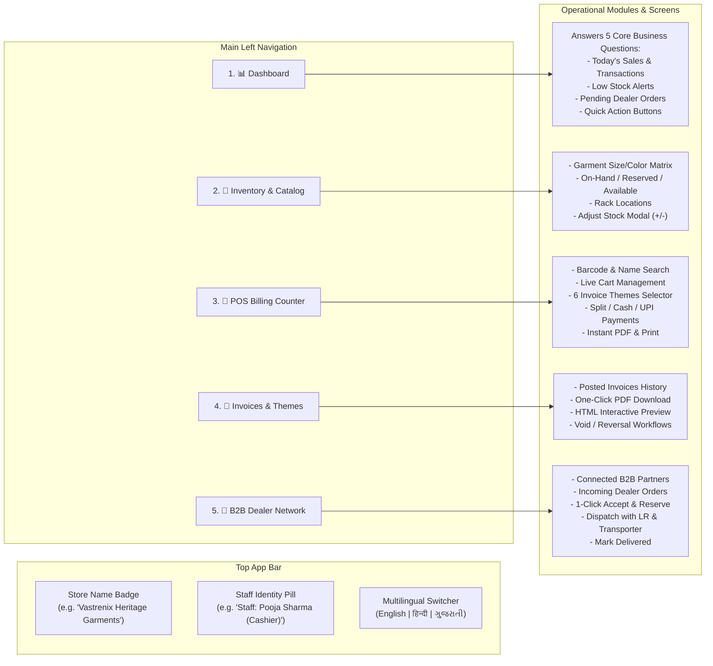
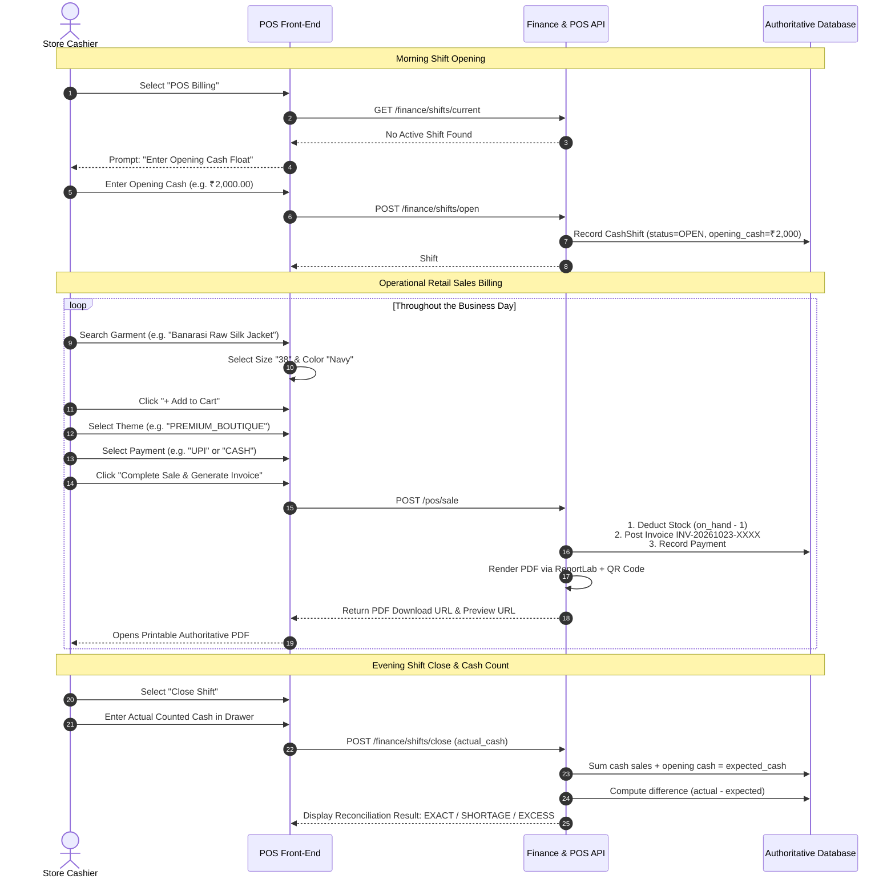
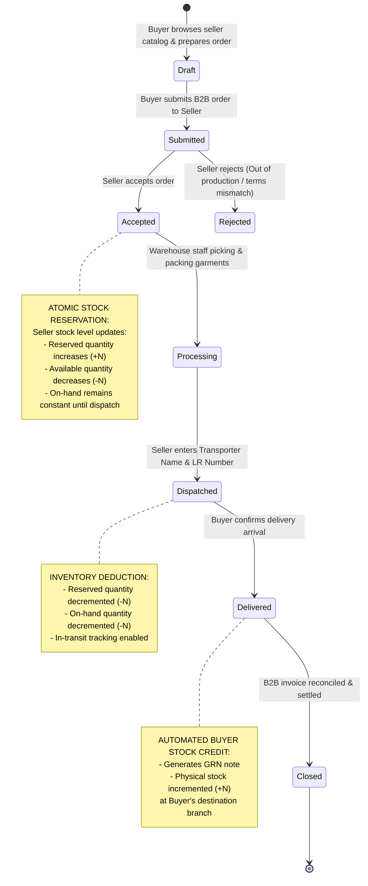

# VASTRENIX — Complete Application Navigation & User Journey Flowcharts

This document provides a comprehensive visual and structural map of the entire **VASTRENIX** platform. It outlines exactly where users go, role-specific access paths, operational state transitions, and step-by-step business workflows.

---

## 1. Master Entry & Authentication Flowchart

---

## 2. Store Administrator Staff Approval Journey

---

## 3. Main Application Navigation Map

Once logged in, the application shell divides into persistent navigation zones:

---

## 4. Cashier Daily Workflow (POS & Shift Reconciliation)

---

## 5. B2B Connected Dealer Order Lifecycle

---

## 6. Where Different User Roles Go (Permission Matrix)

| Screen / Feature | Business Owner | Branch Manager | Cashier | Inventory Mgr | Connected Dealer |
| :--- | :---: | :---: | :---: | :---: | :---: |
| **Dashboard Metrics** | Full Store Performance | Branch Performance | Sales Counter | Stock & Reorder | Own B2B Orders |
| **Staff Approvals** | ✅ Approve / Reject | ❌ Read-Only | ❌ Hidden | ❌ Hidden | ❌ Hidden |
| **Add / Edit Garments** | ✅ Full Access | ✅ Branch Catalog | ❌ Hidden | ✅ Full Access | ❌ Read-Only Catalog |
| **POS Billing Terminal** | ✅ Full Access | ✅ Full Access | ✅ Primary Screen | ❌ View Only | ❌ Hidden |
| **Adjust Physical Stock** | ✅ Full Access | ✅ Branch Level | ❌ Blocked (403) | ✅ Full Access | ❌ Blocked (403) |
| **B2B Dealer Fulfillment**| ✅ Full Access | ✅ View / Pick | ❌ Hidden | ✅ Dispatch / LR | ✅ Place Orders |
| **Financial Reconcile** | ✅ Full Access | ✅ Branch Shifts | ✅ Own Shift Only | ❌ Hidden | ❌ Hidden |

---

## 7. How to Test Each Flow

1. **Test Owner Journey:**
   - Go to `http://localhost:8000`, click **"Store Owner Signup"**.
   - Fill in your store details, enter dashboard, add new garment styles, and manage store operations.
2. **Test Staff Registration & Approval Journey:**
   - Log out, click **"Staff Signup"**.
   - Select the store you created, select role as **`Store Cashier`**, and submit.
   - Try logging in immediately: verify the system blocks login with the pending approval notice.
   - Log back in as Store Owner: see the **Pending Staff Approvals** banner, click **`✓ Approve Staff`**.
   - Log in as the staff member: successfully enters the POS terminal with their **Store Name** prominently showcased in the top bar and sidebar!
3. **Test POS Sale & Invoice Themes:**
   - Add items to cart, switch between all **6 Invoice Themes** (`Classic GST`, `Modern Minimal`, `Premium Boutique`, `Wholesale & Dealer`, `Compact Thermal`, `International Commercial`), complete sale, and inspect the generated PDF.
