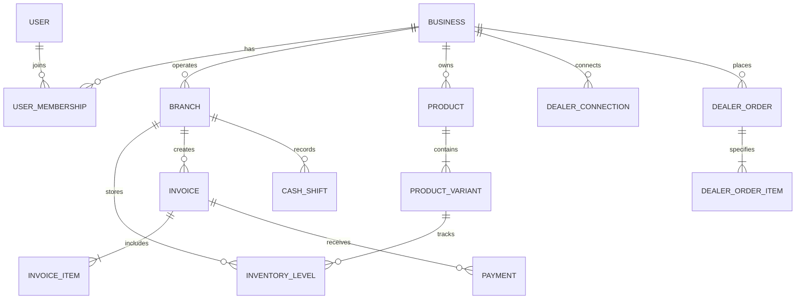

# VASTRENIX System Architecture & Technical Specifications

## 1. High-Level Architecture Overview

```
               [ Cross-Platform Clients ]
    +-----------------------------------------------+
    |  Flutter App (iOS, Android, macOS, Windows)   |
    |  Responsive Web App (Desktop, Tablet, Mobile) |
    +-----------------------------------------------+
                           |
                     HTTPS / JSON REST
                           v
     +---------------------------------------------+
     |             FastAPI Application             |
     |  +---------------------------------------+  |
     |  | JWT Auth & Tenant Scoping Middleware  |  |
     |  +---------------------------------------+  |
     |  |  Role-Based Access Control (RBAC)     |  |
     |  +---------------------------------------+  |
     |  |  Services:                            |  |
     |  |   - Inventory & Variant Manager       |  |
     |  |   - POS & Split-Billing Engine        |  |
     |  |   - 6-Theme PDF Invoice Generator     |  |
     |  |   - Dealer B2B Order Lifecycle Sync   |  |
     |  |   - Cashier Shift & UPI Reconciliation|  |
     |  |   - Offline Queue & Conflict Resolver |  |
     |  +---------------------------------------+  |
     +---------------------------------------------+
              |                             |
              v                             v
    +--------------------+       +----------------------+
    | Relational DB      |       | PDF / QR File Engine |
    | PostgreSQL / SQLite|       | ReportLab + QRCode   |
    +--------------------+       +----------------------+
```

---

## 2. Multi-Tenant Relational Entity Relationship (ER) Model

- **Tenant Boundary:** Every operational entity (`Branch`, `Product`, `Variant`, `InventoryItem`, `Invoice`, `PurchaseOrder`, `DealerOrder`, `CashShift`, `Customer`) carries a strict `business_id` foreign key.
- **Data Isolation:** Enforced at the dependency injection level in FastAPI; queries automatically filter by authenticated `business_id`.



---

## 3. Role & Permission Matrix

| Role | Products & Variants | Stock Adjustments | POS Billing | Invoices & Refunds | Costs & Profit Reports | Dealer Orders | Staff Management |
| :--- | :---: | :---: | :---: | :---: | :---: | :---: | :---: |
| **Owner** | Full | Full | Full | Full | Full | Full | Full |
| **Administrator** | Full | Full | Full | Full | View | Full | Full |
| **Branch Manager** | View/Edit | Full (Branch) | Full | Full (Branch) | View (Branch) | View/Accept | Branch Only |
| **Cashier** | View | None | Create | Create/View | None | None | None |
| **Inventory Manager** | Full | Full | None | None | View Cost | View/Receive | None |
| **Purchase Manager** | View/Edit | Receipts | None | None | Full Purchase | View/Receive | None |
| **Accountant** | View | None | None | View | Full Finance | View Financials| None |
| **Dispatcher** | View | Dispatch Deduct | None | View Slips | None | Dispatch Only | None |
| **Read-only Auditor**| View | View | View | View | View | View | None |

---

## 4. Six Built-in Invoice Themes Specification

1. **Classic GST:** Standard tax invoice featuring dual HSN/SAC table, CGST/SGST/IGST breakdown, authorized signatory box, and terms.
2. **Modern Minimal:** Crisp, editorial typography, subtle dividers, light teal totals card, and prominent UPI QR code.
3. **Premium Boutique:** High-fashion luxury feel, serif headers, fabric care notes, garment breakdown, and return policy badge.
4. **Wholesale & Dealer:** Packed density layout with size-matrix breakdowns (S/M/L/XL/XXL columns), pack counts, transport LR number, and dispatch terms.
5. **Compact Thermal:** High-contrast 80mm/58mm monochrome POS receipt with itemized lines, savings callout, UPI scan code, and cashier footer.
6. **International Commercial:** Multi-currency compliant layout with FOB/CIF terms, country of origin, garment composition, and customs declaration.

---

## 5. Dealer Network Transaction Lifecycle

```
[Buyer Drafts Order]
        |
        v
[Submitted -> Pending Seller Review]
        |
        +-----------------------------------+
        |                                   |
        v                                   v
[Seller Rejects]                    [Seller Accepts / Partially Accepts]
                                            |
                                            v (Atomic Inventory Reservation)
                                    [Processing & Picking]
                                            |
                                            v
                                    [Packed & Barcode Scanned]
                                            |
                                            v
                                    [Dispatched & LR Number Assigned]
                                            |
                                            v
                                    [Delivered & Received into Stock]
                                            |
                                            v
                                    [Closed & B2B Invoice Reconciled]
```
